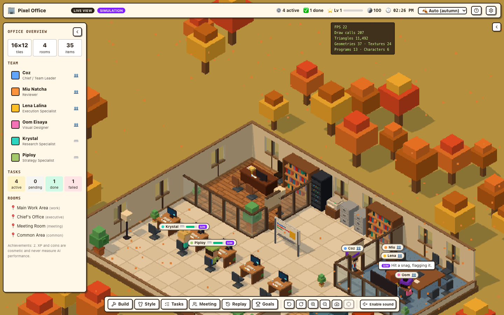

# Pixel Office — Grok Bot 3D Pixel Office Simulator

An isometric, voxel/pixel-art office where the six Bots from the existing
`grok-3d-office` project live, work, meet and wander. Real activity can be shown
from an **authorised local event folder**; otherwise a clearly labelled
**simulation** keeps the office alive. Everything runs locally.



## Run

Requires Node.js 24+ (uses the built-in `node:sqlite`).

```sh
npm install        # first time only (dependencies were cloned from grok-3d-office)
npm run dev        # API on 127.0.0.1:4319 + Vite on 127.0.0.1:5173
```

Open http://127.0.0.1:5173. Other ports:

```sh
OFFICE_PORT=4329 OFFICE_FRONTEND_PORT=5183 npm run dev
```

One command for the full app: `npm start` (builds, then serves everything on http://127.0.0.1:4319).

| Variable | Default | Purpose |
| --- | --- | --- |
| `OFFICE_PORT` | 4319 | Backend (and production) port |
| `OFFICE_FRONTEND_PORT` | 5173 | Vite dev port |
| `OFFICE_DATABASE` | `data/office.db` | SQLite file (`:memory:` for tests) |
| `OFFICE_SIMULATION` | on | `0` disables the simulation provider at start |
| `OFFICE_CACHE_DIR` | — | Pre-authorise a local event folder (operator opt-in) |

If the backend is not reachable, the browser runs the simulation itself and
labels the feed **BROWSER SIMULATION**; it reconnects automatically.

## Chat with a Bot (Grok API)

Click a Bot, then open the **Chat** tab in the right panel. Each Bot has its own conversation:

- Grok answers in that Bot's role, streaming word by word. **Stop** cancels a reply.
- Ask for real work ("Oom, please draft a poster idea for the launch") and the Bot calls a
  `place_task` tool: a **📋 Placed task #N** note appears and the task runs in the queue
  (see it in the **Activity** tab).
- Replies also show as speech bubbles in the office, labeled REAL (live) or SIMULATED (MOCK_MODE).
- History is saved in `data/chats.json` (last 200 messages per Bot; the last 20 are sent to Grok).
  **Clear** wipes one Bot's chat.
- Chat spend counts against the same `DAILY_BUDGET_USD` as tasks. When it is used up, chat pauses.
- API: `GET/DELETE /api/chat/:botId`, `POST /api/chat/:botId {text}` (server-sent events:
  `thinking`, `delta`, `task`, `done`, `error`). Protected by `OFFICE_TOKEN` like `/api/tasks`.

## Results: chat to task to result

- **Chat panel.** Click a Bot. The right panel is one surface: a 36px header (Focus, Follow,
  Clear, and a **…** menu for Profile / Tasks / Activity / Style / Break), the messages, and the
  input pinned at the bottom. Enter sends, Shift+Enter adds a line.
- **Make it a task.** Start a message with `/task`, or switch on the **Task** toggle. The first
  line becomes the title and the rest the details, for the Bot you are chatting with. A live card
  (`#14 Make a picture · running`) shows in the chat, with Cancel and Retry.
- **Saved results.** Every finished or failed task is saved to `data/results/<task_id>.json`
  (`task_id, title, agent, created_at, finished_at, status, output_type, output, files[],
  tokens_in, tokens_out, cost_usd, model`) and listed in `data/results/index.json`. Files go to
  `data/results/files/<task_id>/` and are served only by this local server, as downloads or
  images, with `nosniff` and a sandbox CSP. All writes are atomic.
- **Outputs.** Markdown and code are rendered (each code block has a Copy button) without ever
  inserting HTML from the model. Image tasks save the image prompt and an SVG drawing. Set
  `IMAGE_API=true` to also generate a real image with xAI's `POST /v1/images/generations`
  (docs.x.ai/docs/guides/image-generations, about $0.04 per image, charged to the daily budget).
- **Completion pop-up.** One window over the office with the output, Copy, Download, Open in Results
  board and Close. Several results finishing together are paged (“1 of 3”). Esc or a click outside
  closes it. Settings → *Pop-up on completion*: Always / Only when I am in the app / Off (a toast
  with an Open button instead).
- **Results board.** Use the **Results** toolbar button; the number on it is the unread count. The
  board has a list on the left (newest first, virtualized), the detail view on the right, and
  filters (search, agent, status, type, date range). It also offers Re-run, Delete (asks first),
  Pin, and Export as `.md` or `.zip`. *Keep last N* sets retention, and pinned results are never
  deleted. The board updates live from the existing event stream.
- API: `GET /api/results`, `GET|PATCH|DELETE /api/results/:id`, `POST /api/results/:id/rerun`,
  `GET /api/results/:id/files/:name`, `GET /api/results/:id/download`,
  `GET /api/results/export.md|zip`, `PUT /api/results/settings {keep}`,
  `POST /api/chat/:botId/task {text}`. These are protected by `OFFICE_TOKEN` like `/api/tasks`.

## Place a task (Grok API)

Select any Bot → **Conversation** tab. Task threads are listed at the top, and
the form is pinned at the bottom. Fill in a title, optional details (▸), agent
(**Auto** or one of the six) and priority, then **Send**. Enter sends;
Shift+Enter adds a new line. Each task appears at once as a thread
(`#3 Write report  queued → running → done`) with Cancel and Retry. The chosen
Bot walks to its desk and works while Grok streams its reply into the thread
and the office.

**Setup**

```sh
cp .env.example .env   # already done once; .env is gitignored
# edit .env: paste your key after XAI_API_KEY=, then set MOCK_MODE=false
npm start
```

| `.env` field | Default | Meaning |
| --- | --- | --- |
| `XAI_API_KEY` | — | Your xAI key. Read only by the local server; never sent to the browser or logged. |
| `XAI_BASE_URL` | `https://api.x.ai/v1` | OpenAI-compatible endpoint (`/chat/completions`). |
| `DEFAULT_MODEL` | `grok-4.3` | Cheapest model with tool calling ($1.25 / $2.50 per 1M tokens in/out). |
| `MAX_TOKENS_PER_TASK` | 20000 | Total tokens one task may use (all turns); also sets the cost shown under the form. |
| `DAILY_BUDGET_USD` | 1 | No task starts, and Send is disabled, once today's (UTC) spend reaches this. |
| `MOCK_MODE` | `true` | Fake streamed replies, with no API call and no cost. Set `false` **and** add a key for real Grok. |
| `OFFICE_TOKEN` | — | Optional. Requires an `x-office-token` header on `/api/tasks` (the form asks for it once). |

`TASK_CONCURRENCY` (2), `MAX_TURNS` (6) and `XAI_TIMEOUT_MS` (120000) are optional.

**Turning off MOCK_MODE**: put your key in `.env`, change `MOCK_MODE=true` to
`MOCK_MODE=false`, and restart `npm start`. The server prints which mode it is
in. Without a key it always stays in mock mode, so a typo can't cause a paid
call. Live Grok tasks are labelled **REAL**; mock tasks are labelled **SIMULATED**.

**How it works**: `POST /api/tasks` validates and queues the task, and a worker
runs at most 2 at a time (highest priority first, one per Bot). `runAgent`
(`backend/src/grok.ts`) streams Grok's reply and turns tool calls
(`move_to`, `say`, `finish_task`) into office events. Every event records
`tokens_in`, `tokens_out` and `model`. A task stops after 6 turns or when it
passes its `max_cost_usd`. 429/5xx errors are retried 3 times with backoff.
The queue and today's spend are saved in `data/tasks.json`. A task that was
running during a restart is marked failed (use Retry), never re-run on its own.
Also available: `GET /api/tasks`, `POST /api/tasks/:id/cancel`, `POST /api/tasks/:id/retry`.

Try the whole flow for free: `npm run tasks:demo` submits 3 tasks in MOCK_MODE
and prints every event. The public preview has no server, so placing tasks only
works locally.

## What you can do

- **Watch** Bots work at their desks, think, walk, take coffee breaks, chat, visit
  the Chief, and gather in the meeting room. Click a Bot for its profile, current
  task, task history and conversation; double-click to follow.
- **Build** (`B`): place furniture from a searchable catalog (click or drag onto the
  floor), move by dragging, rotate (`R`), delete, paint floors, paint/create rooms,
  add walls / glass / windows / doors / partitions, expand or shrink the office on
  any side, undo/redo, save/load named layouts, export/import JSON, reset. Every edit
  is validated: no overlaps, nothing outside the office, no furniture through walls,
  and routes to the entrance, every assigned desk, every room and the meeting seats
  stay open.
- **Style** each Bot: hair, colours, skin, outfit, glasses, hats, accessories,
  expression, idle animation, with a live 3D preview. Cosmetic only.
- **Tasks** dashboard: totals, active/pending/completed/failed, completion rate,
  tasks-by-Bot, full task table, filters by Bot/status/period/source. Clicking a row
  focuses that Bot.
- **Meetings**: live meeting panel; start a *simulated* demo meeting.
- **Replay** recorded sessions (0.5×–4×, scrub, jump to time, inspect events, follow
  a Bot); gaps in data are drawn as gaps. A fully simulated replay demo is included.
- **Goals**: cosmetic XP, coins, office level, unlockable furniture/accessories and
  achievements.
- **Seasons** (auto from the calendar or manual), optional day/night cycle,
  seasonal particles, clouds, rain/snow — decorative, never live weather.
- **Sound**: procedural Web-Audio typing, footsteps, chairs, coffee machine,
  printer, AC hum, chatter and notifications; off until you enable it.
- **Settings**: graphics LOW/MEDIUM/HIGH, pixel-art toggle, wall height,
  performance overlay (FPS, draw calls, triangles, geometries, textures).

Controls: left-drag pan · wheel zoom · right/middle-drag or `Q`/`E` rotate ·
`WASD`/arrows pan · `0` reset · `F` follow · `B` build · `R` rotate · `Del` delete ·
`Esc` cancel · `Ctrl+Z` / `Ctrl+Shift+Z` undo/redo.

**On a phone or tablet**: drag to pan, pinch to zoom, twist with two fingers to
rotate, tap a Bot to select it. Side panels open one at a time as sheets, the
toolbar shows icons only, and the camera re-fits when you rotate the device.
In Build mode, tap a catalog item (the builder folds away), then tap the floor.
Touch devices start on the LOW graphics preset.

## Real vs simulated data

Every event, task, message and meeting carries one of four labels and the UI shows
it everywhere it matters:

| Label | Meaning |
| --- | --- |
| **REAL** | From the authorised local folder **and** the record explicitly says `"source":"real"` |
| **SIMULATED** | Generated by the simulation provider (or a record that says so) |
| **REPLAYED** | Historical playback (original label kept and shown) |
| **UNKNOWN** | A local record without a trustworthy label |

Walking, coffee breaks and chats are visual simulation and never change task
data. A Bot walks to its desk only for an active task, and a task shows as
completed only when a completion event arrives. Unknown progress is drawn as an
indeterminate bar. XP and coins never count UNKNOWN or REPLAYED events, and they
do not measure AI performance.

### Providers

- **A — Local cache (read-only).** Settings → Data sources → choose one folder,
  tick the authorisation box, Connect. Reads `*.jsonl` / `*.ndjson` in that folder
  only, with no recursion and no symlinks, skips names that look like credentials,
  and refuses `~/.grokbot`, `~/.ssh`, Keychains, Cookies, `~/.aws`, `~/.gnupg`, `/`
  and `~`. It is incremental, handles rotation and truncation, deduplicates by
  event id, and recovers from errors. One JSON object per line:

  ```json
  {"id":"evt-1","botId":"mock-research-02","taskId":"t-1","timestamp":"2026-11-20T01:00:00Z",
   "type":"task_started","source":"real","payload":{"title":"…","progress":0.2}}
  ```

  `type` ∈ `task_created, task_started, task_updated, task_completed, task_failed,
  message, meeting_started, meeting_ended, status_changed`. `botId` must be a
  roster id. `payload.progress` is optional (0–1). Meeting events use
  `payload.meetingId`, `payload.title` and `payload.participants`. See
  `examples/local-cache/sample-events.jsonl`.
- **B — Simulation.** Seeded fictional tasks, progress, chatter and meetings.
- **C — Official API adapter.** Interface only, always *unavailable*: no official
  Grok Bot event API is documented, so nothing is called.

**About Grok Bot itself:** earlier research in `grok-3d-office` (docs/api-schema-report.md,
docs/live-integration-results.md) found no public API and no verified, readable
activity cache. This app therefore never reads Grok Bot's private application
data. Point Provider A at a folder written by an exporter you control.

## Tests

```sh
npm test            # 40 unit/integration tests (layout, A*, behaviour FSM, tasks, dedupe,
                    #   classification, replay, seats, bubbles, game layer, local cache, API)
npm run test:e2e    # 7 Playwright browser tests (scene, selection, dashboard, meeting,
                    #   build/undo/expand, replay, collision + camera + stats)
npm run check       # typecheck + lint + unit tests + build
```

See [docs/architecture.md](docs/architecture.md) for the design and known limitations.
